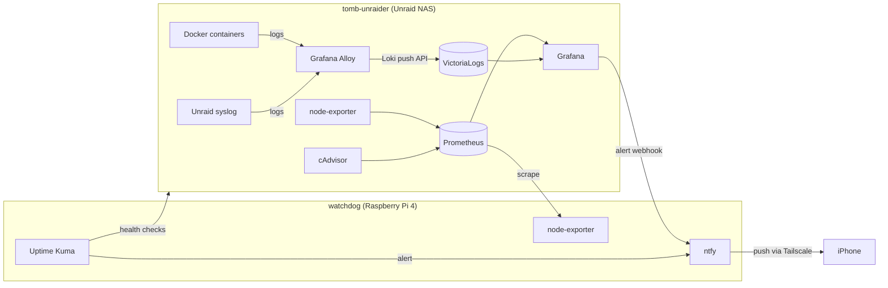

# Homelab Observability Stack

Self-hosted log aggregation, metrics, dashboards, and alerting for the homelab: a free, lightweight alternative to Splunk built from open-source components.

## Architecture



Each host watches the other. If the NAS goes down, Uptime Kuma on the Pi alerts. If the Pi goes down, Grafana's `up` rule alerts. Alerts go out through a self-hosted ntfy server that is reachable only over Tailscale.

## Components

| Component | Host | Purpose |
|---|---|---|
| Grafana | NAS | Dashboards and alert rules |
| Prometheus | NAS | Metrics storage (30-day retention) |
| node-exporter | NAS + Pi | Host CPU, memory, disk, and network metrics |
| cAdvisor | NAS | Per-container resource metrics |
| VictoriaLogs | NAS | Log storage and search with LogsQL (30-day retention) |
| Grafana Alloy | NAS | Ships Docker container logs and Unraid syslog |
| ntfy | Pi | Self-hosted push notifications, `deny-all` auth with per-service tokens |
| Uptime Kuma (v2) | Pi | Independent uptime checks of NAS services, the Wazuh dashboard, and the Wazuh manager's agent port |

Wazuh remains the SIEM for security detections. This stack covers general log search, performance, and availability.

## Layout

```
tomb-unraider/
  docker-compose.yml
  .env.example
  prometheus/prometheus.yml
  alloy/config.alloy
watchdog/
  docker-compose.yml
  ntfy/server.yml
grafana/
  alert-rules.yaml        # exported Grafana-managed alert rules
```

## Alert rules

| Rule | Source | Condition | Pending |
|---|---|---|---|
| Disk almost full | Prometheus | xfs/btrfs/ext4 mount > 85% used | 10m |
| High CPU | Prometheus | > 90% busy per host | 15m |
| Container stopped | Prometheus (cAdvisor) | Container unseen > 120s, per container name | 5m |
| Container restart loop | Prometheus (cAdvisor) | > 3 restarts in 15m, per container name | 0s |
| Scrape target down | Prometheus | `up < 1` | 2m |
| Authentik failed logins | VictoriaLogs | > 5 `Invalid credentials` events in 5m | 0s |

The container rule uses `max_over_time(container_last_seen[1d])`, so new containers are covered automatically and no hard-coded container count is needed. The restart-loop rule (`changes(container_start_time_seconds[15m])`) covers the case it misses: a container that keeps crashing never disappears from cAdvisor, so "stopped" never fires.

## Deployment notes and lessons learned

- **Unraid root filesystem is not a shared mount.** node-exporter's usual `/:/host:ro,rslave` fails with `path / is mounted on / but it is not a shared or slave mount`. Use `/:/host:ro` on Unraid. The Pi works fine with `rslave`.
- **Unraid's `/proc/mdstat` is non-standard.** node-exporter's mdadm collector errors on every scrape, so it is disabled with `--no-collector.mdadm`.
- **VictoriaLogs needs to know which field holds the message.** Apps disagree on the name (Authentik uses `event`). The Alloy push URL sets `_msg_field=msg,message,event,log`.
- **Label collisions.** Authentik's JSON logs contain a `host` field (the HTTP Host header) that clashed with the Alloy `host` label. Alloy uses `server` as the machine label instead.
- **LogsQL word filters only search `_msg`.** Use `field:value` to match structured fields.
- **Log-based alerts return no rows when nothing matches.** Set "Alert state if no data" to **Normal**, or the rule pages on every quiet period.
- **Containers can't resolve Tailscale MagicDNS names.** Grafana reaches ntfy over the LAN; phones reach it over Tailscale HTTPS (`tailscale serve`).
- **iOS push with self-hosted ntfy** requires `upstream-base-url: https://ntfy.sh`. Only a content-free poll request goes upstream, and the message itself stays on the Pi.
- **`louislam/uptime-kuma:latest` still points to the unmaintained v1.** Pin `:2`.
- **Prometheus on `/mnt/user`** runs through Unraid's FUSE layer (shfs). Pointing the data volume at the cache pool directly avoids that overhead.

## Incidents

Problems found and fixed in the first day of running the stack. Each one led to a monitoring or process change.

### INC-1: Nextcloud crash loop after an unattended two-version upgrade

**Symptom:** 502 from the reverse proxy. The container showed "Up" but kept restarting.

**Cause:** The `latest` image moved from Nextcloud 33 to 35 and was pulled automatically. Nextcloud only upgrades one major version at a time, so it refused to start:

```
Can't start Nextcloud because the version of the data (33.0.5.1) is more than one
major version behind the docker image version (35.0.2.2)
```

**Fix:** Pinned the image to LinuxServer's prior-major tag (`previous-version-34.0.5`) to upgrade 33 → 34, then returned to `latest` for 34 → 35.

**What else it exposed:**
- **Monitoring gap.** No alert fired, because the container never disappeared. Added the *Container restart loop* rule.
- **Empty backups.** The pre-upgrade database dump used the MariaDB container's `MYSQL_ROOT_PASSWORD` variable, which no longer matched the real root password, so the dump was empty. Backups now use Nextcloud's own database credentials (`scripts/backup/nextcloud-backup.sh`).
- **Update policy.** Nextcloud is excluded from automatic container updates and upgraded manually, one major version at a time, after a backup.

**Residual:** `occ db:schema:check` reports `oc_share_external: column 'id' differs in: autoincrement` on Nextcloud 35. The column already has a working AUTO_INCREMENT, and other NC35 users report the same line. It's treated as cosmetic and left unmodified until an upstream fix.

### INC-2: Wazuh dashboard 502 on single sign-on login

**Symptom:** 502 only after authenticating through Authentik (OpenID Connect). The dashboard itself was reachable.

**Cause:** The reverse proxy's error log showed:

```
upstream sent too big header while reading response header from upstream,
request: "GET /auth/openid/login?code=..."
```

The OIDC callback returns a session cookie containing the identity token, which exceeds nginx's default 4–8 KB proxy buffer.

**Fix:** Larger buffers on the Wazuh proxy host (`configs/npm/wazuh-advanced.conf`):

```nginx
proxy_buffer_size 128k;
proxy_buffers 4 256k;
proxy_busy_buffers_size 256k;
large_client_header_buffers 4 32k;
```

`large_client_header_buffers` prevents the follow-on `400 Request Header Or Cookie Too Large` once the browser sends the large cookie back.

### INC-3: Wazuh indexer approaching the per-node shard limit

**Symptom:** None yet. Found while checking cluster health after INC-2.

**Cause:** 814 of OpenSearch's default 1,000 shards per node were in use: 240 daily `wazuh-alerts-*` indices at 3 shards each, kept indefinitely. At 3 new shards per day, the limit would have been reached in about 60 days. After that, new indices can't be created, and Wazuh stops storing alerts while the dashboard keeps working.

**Fix:**
- **Retention.** An Index State Management policy deletes `wazuh-alerts-*` and `wazuh-archives-*` indices after 90 days (`configs/wazuh/ism-retention.json`), applied to new and existing indices.
- **Shard count.** The Wazuh index template is set to 1 shard per daily index. Multiple shards only help multi-node clusters.
- **Expected steady state:** about 180–200 shards.

**Lesson:** "green" cluster health says nothing about headroom. Shard count and disk usage need tracking too.

## Secrets

No secrets are committed. The Grafana admin password lives in `.env` (see `.env.example`). ntfy tokens live in Grafana's contact point and Uptime Kuma's notification settings. Hostnames, IPs, and domains are replaced with placeholders such as `<nas-ip>` and `<tailnet>`.
