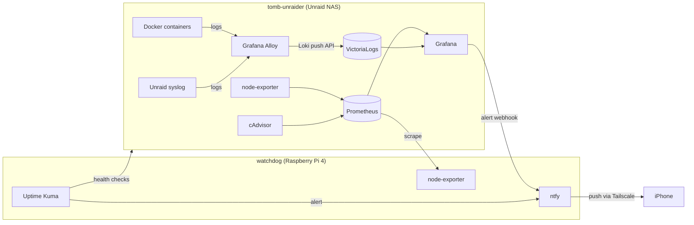

# Homelab Observability Stack

Self-hosted log aggregation, metrics, dashboards, and alerting for the homelab: a free, lightweight alternative to Splunk built from open-source components.

## Architecture



Each host watches the other. If the NAS goes down, Uptime Kuma on the Pi alerts. If the Pi goes down, Grafana's `up` rule alerts. Alerts go out through a self-hosted ntfy server that is reachable only over Tailscale.

## Components

| Component | Host | Purpose |
|---|---|---|
| Grafana | NAS | Dashboards and alert rules |
| Prometheus | NAS | Metrics storage (30-day retention) |
| node-exporter | NAS + Pi | Host CPU, memory, disk, and network metrics |
| cAdvisor | NAS | Per-container resource metrics |
| VictoriaLogs | NAS | Log storage and search with LogsQL (30-day retention) |
| Grafana Alloy | NAS | Ships Docker container logs and Unraid syslog |
| ntfy | Pi | Self-hosted push notifications, `deny-all` auth with per-service tokens |
| Uptime Kuma (v2) | Pi | Independent uptime checks of NAS services |

Wazuh remains the SIEM for security detections. This stack covers general log search, performance, and availability.

## Layout

```
tomb-unraider/
  docker-compose.yml
  .env.example
  prometheus/prometheus.yml
  alloy/config.alloy
watchdog/
  docker-compose.yml
  ntfy/server.yml
grafana/
  alert-rules.yaml        # exported Grafana-managed alert rules
```

## Alert rules

| Rule | Source | Condition | Pending |
|---|---|---|---|
| Disk almost full | Prometheus | xfs/btrfs/ext4 mount > 85% used | 10m |
| High CPU | Prometheus | > 90% busy per host | 15m |
| Container stopped | Prometheus (cAdvisor) | Container unseen > 120s, per container name | 5m |
| Scrape target down | Prometheus | `up < 1` | 2m |
| Authentik failed logins | VictoriaLogs | > 5 `Invalid credentials` events in 5m | 0s |

The container rule uses `max_over_time(container_last_seen[1d])`, so new containers are covered automatically and no hard-coded container count is needed.

## Deployment notes and lessons learned

- **Unraid root filesystem is not a shared mount.** node-exporter's usual `/:/host:ro,rslave` fails with `path / is mounted on / but it is not a shared or slave mount`. Use `/:/host:ro` on Unraid. The Pi works fine with `rslave`.
- **Unraid's `/proc/mdstat` is non-standard.** node-exporter's mdadm collector errors on every scrape, so it is disabled with `--no-collector.mdadm`.
- **VictoriaLogs needs to know which field holds the message.** Apps disagree on the name (Authentik uses `event`). The Alloy push URL sets `_msg_field=msg,message,event,log`.
- **Label collisions.** Authentik's JSON logs contain a `host` field (the HTTP Host header) that clashed with the Alloy `host` label. Alloy uses `server` as the machine label instead.
- **LogsQL word filters only search `_msg`.** Use `field:value` to match structured fields.
- **Log-based alerts return no rows when nothing matches.** Set "Alert state if no data" to **Normal**, or the rule pages on every quiet period.
- **Containers can't resolve Tailscale MagicDNS names.** Grafana reaches ntfy over the LAN; phones reach it over Tailscale HTTPS (`tailscale serve`).
- **iOS push with self-hosted ntfy** requires `upstream-base-url: https://ntfy.sh`. Only a content-free poll request goes upstream, and the message itself stays on the Pi.
- **`louislam/uptime-kuma:latest` still points to the unmaintained v1.** Pin `:2`.
- **Prometheus on `/mnt/user`** runs through Unraid's FUSE layer (shfs). Pointing the data volume at the cache pool directly avoids that overhead.

## Secrets

No secrets are committed. The Grafana admin password lives in `.env` (see `.env.example`). ntfy tokens live in Grafana's contact point and Uptime Kuma's notification settings. Hostnames, IPs, and domains are replaced with placeholders such as `<nas-ip>` and `<tailnet>`.
